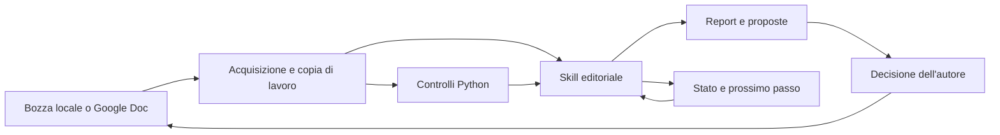

# Officina Racconti

### Dalla bozza alla revisione, con un autore al comando.

[](https://github.com/Flavio2702/officina-racconti/actions/workflows/test.yml)
[](LICENSE)

Un laboratorio open source per lavorare sui racconti in italiano con **Codex o Claude Code**: sei skill editoriali, controlli Python e un metodo per riprendere il lavoro senza ricominciare ogni volta da zero.

Porti una bozza. L'officina organizza le scelte, accompagna la revisione e conserva le consegne tra una sessione e l'altra. **La voce e l'ultima parola restano a chi scrive.**

## Cosa ci puoi fare

- **Dare una direzione alla bozza:** chiarire nucleo, punto di vista, cambiamento ed effetto sul lettore.
- **Revisionare con un obiettivo:** struttura, scena, riga, redazione o bozze; un livello per volta.
- **Ottenere una lettura a freddo:** seguire aspettative e reazioni di un lettore simulato, prima che conosca le tue intenzioni.
- **Usare l'AI per scrivere solo quando lo chiedi:** raccordi, varianti, abbozzi e lucidature hanno una skill esplicita.
- **Controllare il testo:** parole, battute, dialoghi, ripetizioni candidate, differenze tra versioni e coincidenze con materiali dell'assistente.
- **Riprendere il filo:** decisioni, proposte e prossimo passo rimangono in file leggibili, insieme alla versione esaminata.

## Provalo subito

Per i comandi locali basta **Python 3.11 o successivo**, senza pacchetti da installare. Per le skill serve anche un accesso a Codex oppure Claude Code; servizi e relativi costi non sono inclusi. Git è facoltativo se scarichi lo ZIP da **Code → Download ZIP**.

```bash
git clone https://github.com/Flavio2702/officina-racconti.git
cd officina-racconti
python -X utf8 strumenti/prepara.py
python -X utf8 strumenti/prosa.py nuovo il-faro
```

Apri `racconti/il-faro/scheda.md` e imposta la fonte, lasciando vuoto `doc:`:

```yaml
fonte_file: esempi/il-faro.md
```

Poi importa il testo dimostrativo ed esegui i controlli:

```bash
python -X utf8 strumenti/prosa.py importa esempi/il-faro.md il-faro
python -X utf8 strumenti/prosa.py conta il-faro
python -X utf8 strumenti/prosa.py controlla il-faro
```

Vedrai conteggi e segnalazioni da valutare, senza modificare l'originale. Se il tuo sistema usa `python3`, sostituiscilo a `python` in tutti i comandi. `nuovo` rifiuta di sovrascrivere un racconto esistente; `prepara.py` conserva le impostazioni già presenti.

Il [testo dimostrativo](esempi/README.md) è sintetico e non rappresenta la voce di un autore.

## Apri il laboratorio nel tuo assistente

**Codex:** apri la cartella come progetto. Le skill sono in `.agents/skills/`; richiama quelle disponibili con `$racconto-…`. Se non compaiono, riavvia la sessione. [Documentazione ufficiale](https://learn.chatgpt.com/docs/build-skills).

**Claude Code:** apri la stessa cartella. I rimandi in `.claude/skills/` espongono `/racconto-…`. Verifica che siano state caricate le istruzioni di `AGENTS.md`: la lettura diretta richiede una versione compatibile e può essere influenzata da altri file di istruzioni. Se necessario, crea localmente un `CLAUDE.md` con `@AGENTS.md`. [Skill](https://code.claude.com/docs/en/skills) · [Istruzioni di progetto](https://code.claude.com/docs/en/memory#agentsmd).

Per una tua bozza, salvala in `bozze/` e inizia una nuova chat:

```text
$racconto-nuovo bozze/la-mia-bozza.md
```

In Claude Code usa `/racconto-nuovo`. L'assistente prepara cartella, scheda e stato, poi indica il prossimo passo. Sono supportati file `.md`, `.txt` e `.docx`; Google Docs è opzionale e ha una [guida dedicata](docs/google-docs.md).

## Sei skill, compiti distinti

| Skill | A cosa serve |
| --- | --- |
| `racconto-nuovo` | Impostare il progetto a partire da una bozza o un'idea |
| `racconto-nucleo` | Esplorare struttura, direzioni e scaletta inversa |
| `racconto-revisione` | Diagnosticare un livello del testo senza riscriverlo |
| `racconto-lettore` | Simulare la lettura a tappe in una chat nuova |
| `racconto-scrittura` | Proporre prosa su richiesta esplicita |
| `racconto-voce` | Costruire un profilo personale solo su richiesta esplicita |

Un percorso possibile: **bozza → nucleo → lettura a freddo → revisione strutturale → revisione di riga → redazione**. Ogni passaggio ampio ha una chat dedicata; lo stato rende possibile il passaggio di consegne.



## Le scelte dietro il progetto

**Istruzioni e misure fanno lavori diversi.** Le skill guidano il processo editoriale; Python esegue conteggi e confronti ripetibili usando solo la libreria standard.

**Ogni report ha un riferimento.** Le impronte SHA-256 collegano i report alla copia esaminata. La provenienza dichiarata e le consegne aiutano a distinguere osservazioni attuali da quelle superate.

**Le proposte rimangono visibili.** La revisione indica problemi e direzioni; la scrittura assistita è separata. Con fonti locali, le modifiche restano proposte che l'autore applica all'originale.

**Un solo insieme di skill.** I rimandi per Claude Code puntano alle stesse istruzioni usate da Codex; i test ne controllano l'allineamento.

**Le misure di voce descrivono, non attribuiscono.** `confronta`, `deriva` e `voce` leggono un passaggio contro la variazione dei testi dell'autore su pezzi della stessa lunghezza: il racconto stesso e i racconti consolidati, solo nelle frasi senza coincidenze con i materiali dell'assistente. Non c'è un valore da raggiungere; metodo, limiti e calibrazione sono in [officina/stilometria.md](officina/stilometria.md). Senza racconti consolidati il corpus è vuoto e i comandi lo dicono; i marcatori di voce si scrivono in `strumenti/marcatori_voce.txt`, creato vuoto da `prepara.py`.

## I tuoi testi restano fuori dal repository

`racconti/` (tranne il modello vuoto), `bozze/`, `voce/` e le personalizzazioni locali sono ignorati da Git. I modelli pubblici non contengono profili personali. Salva i tuoi materiali nelle cartelle previste e controlla i file prima di ogni commit: un file personale salvato altrove non è automaticamente protetto.

L'esclusione da Git riguarda la pubblicazione, **non l'invio di contenuti al servizio AI** quando usi un assistente. Conserva un backup separato dei tuoi testi e non inserire contenuti riservati nelle issue.

## Limiti e verifiche

Le segnalazioni linguistiche sono euristiche; la lettura simulata non predice il giudizio di una giuria. Il confronto di provenienza misura coincidenze, non certifica chi abbia scritto un testo. L'importazione DOCX conserva la prosa ordinaria e il corsivo diretto, non tutta l'impaginazione o gli stili ereditati.

La suite verifica gli strumenti locali, l'allineamento delle skill, l'avvio rapido e le esclusioni dei file privati. Non certifica la qualità delle risposte di un modello. Le scritture remote su Google Docs non sono collaudate in questa distribuzione.

```bash
python -X utf8 -m unittest discover -s strumenti -p "test_*.py"
python -X utf8 strumenti/prosa.py aiuto
```

La stessa suite gira su GitHub Actions per Windows e Linux. Altri comandi e prove manuali: [guida d'uso](docs/uso.md).

## Contribuire e riutilizzare

Hai trovato un problema? Apri una issue con un esempio inventato e i passaggi per riprodurlo. Per una modifica, aggiungi una prova quando cambia il comportamento ed esegui la suite. Miglioramenti alle istruzioni devono mantenere l'allineamento tra le skill e i rimandi.

I contributi originali sono sotto [Apache-2.0](LICENSE). Le idee e i materiali adattati da altri progetti mantengono [crediti e licenze](CREDITI.md); le fonti editoriali sono raccolte in [officina/fonti.md](officina/fonti.md).
